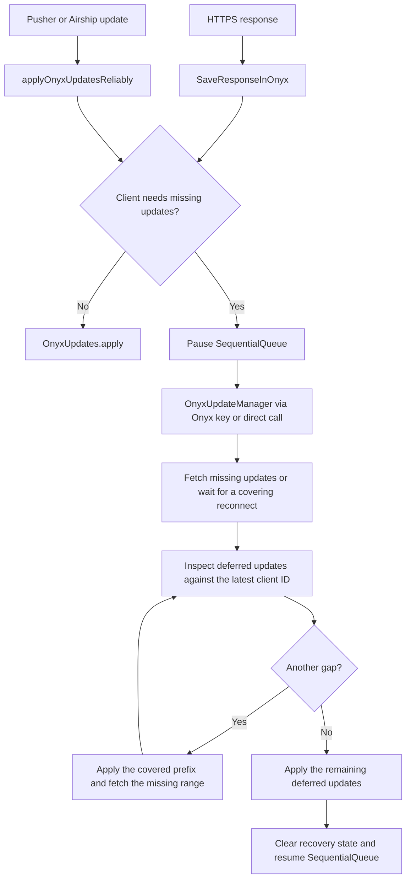

# Onyx update manager

Server updates reach the app through HTTPS responses, Pusher events, and Airship push notifications. Those transports can deliver overlapping updates or leave gaps. `OnyxUpdateManager` recovers missing updates before replaying the updates waiting behind them.

This guide explains the update IDs and deferred-update flow. See [SequentialQueue](SEQUENTIAL_QUEUE.md) for outgoing requests, WRITE-response buffering, and recovery timers.

## Contents

* [Where updates enter](#where-updates-enter)
* [How update IDs describe a gap](#how-update-ids-describe-a-gap)
* [Recovery flow](#recovery-flow)
* [How deferred updates are replayed](#how-deferred-updates-are-replayed)
* [Recovery branches and safeguards](#recovery-branches-and-safeguards)
* [Which module to read](#which-module-to-read)

## Where updates enter

| Transport | Entry point | When the client needs missing updates |
| --- | --- | --- |
| HTTPS | [`SaveResponseInOnyx`](../src/libs/Middleware/SaveResponseInOnyx.ts) | Saves the response in `ONYX_UPDATES_FROM_SERVER` and returns `shouldPauseQueue`, which makes `SequentialQueue` pause. |
| Pusher | [`subscribeToUserEvents`](../src/libs/actions/User.ts) calls [`applyOnyxUpdatesReliably`](../src/libs/actions/applyOnyxUpdatesReliably.ts). | Pauses `SequentialQueue` and saves the event in `ONYX_UPDATES_FROM_SERVER`. |
| Airship | [`subscribeToPushNotifications`](../src/libs/Notification/PushNotification/subscribeToPushNotifications.ts) calls `applyOnyxUpdatesReliably` with `shouldRunSync: true`. | Pauses `SequentialQueue` and calls `handleMissingOnyxUpdates` directly. This also works in the Android background callback, where the Onyx subscription callbacks do not run. |

`OnyxUpdateManager` subscribes to `ONYX_UPDATES_FROM_SERVER`. This Onyx key lets response middleware signal a gap without importing the manager, which itself makes API requests through that middleware. The direct push-notification path passes the stored client update ID explicitly.

These entry points apply updates through `OnyxUpdates.apply` when no recovery is needed. Some HTTPS commands bypass gap detection because they fetch recovery data themselves or must unblock authentication. The command lists in `SaveResponseInOnyx` define those exceptions.

## How update IDs describe a gap

| Value | Meaning |
| --- | --- |
| `lastUpdateID` | The server update ID reached by a payload. |
| `previousUpdateID` | The server update ID the client must already cover before applying that payload. |
| `ONYX_UPDATES_LAST_UPDATE_ID_APPLIED_TO_CLIENT` | The client's applied update ID, stored in Onyx. The code also calls this the persisted watermark. |

IDs describe a chain. Do not assume that the next ID is the current ID plus one, or that `previousUpdateID` must equal the client's ID. A payload can overlap updates already applied.

For a client that covers update `100`, these are the normal outcomes:

| `previousUpdateID` | `lastUpdateID` | Outcome |
| --- | --- | --- |
| `100` | `120` | Apply the payload. It continues the chain. |
| `90` | `120` | Apply the newer payload. Its prerequisite is already covered. |
| `80` | `100` | The server payload is already covered. Skip its server data. |
| `120` | `130` | Defer the payload, fetch the missing range from `100` through `120`, then replay the payload ending at `130`. |

Skipping an old HTTPS payload does not skip the request's local `successData`, `failureData`, or `finallyData`. `OpenApp` and a full `ReconnectApp` also bypass the old-payload check because they establish the app's base state.

### Applied IDs and updates still in progress

The ID stored in Onyx advances after an update applies successfully. HTTPS WRITE responses are buffered until the request queue drains, so the ID can lag behind responses already received.

`getEffectiveLastUpdateID()` normally includes the highest WRITE update ID waiting for that flush. Gap detection also counts an in-flight Pusher update when the incoming transport will apply behind it. This avoids fetching updates that are already waiting to be written. An independent Airship apply cannot assume that a Pusher write has finished.

Catch-up responses use the persisted ID for the old-payload check. Comparing them only with the higher buffered ID could discard the very response needed to close a gap. If an apply fails, `OnyxUpdates` holds back advancement until a response covers the missing range. See [failed applies and watermark recovery](SEQUENTIAL_QUEUE.md#pausing--data-gap-sync) for that contract.

## Recovery flow

The diagram shows the normal gap-recovery flow. Pending-update notifications, startup guards, and recovery failures are described below.



`getMissingOnyxUpdates(updateIDFrom, updateIDTo)` calls the backend command `GetMissingOnyxMessages`. `updateIDFrom` is exclusive: the client asks for updates after the ID it already has. These `GetMissingOnyxMessages` requests bypass the paused sequential queue so that fetching the gap does not depend on that queue resuming.

## How deferred updates are replayed

`DeferredOnyxUpdates` keeps an in-memory dictionary keyed by `lastUpdateID`. During a gap, the manager adds the triggering payload and collects further payloads. When two transports deliver the same ID, the single-payload enqueue path prefers HTTPS because it includes the request's local success, failure, and final data.

After the first fetch, `validateAndApplyDeferredUpdates` reads the latest effective client ID. It uses the greater of that value and any explicitly supplied client ID, so a client ID captured before a request cannot move validation backwards.

`detectGapsAndSplit` removes payloads already covered by the client and partitions the remaining payloads into a covered prefix and a suffix after the last gap. For example, with client ID `100`:

```text
Deferred payloads, shown as previousUpdateID -> lastUpdateID:
100 -> 110
120 -> 130
140 -> 150
150 -> 160

Applicable prefix: 100 -> 110
Latest missing ID: 140
Suffix to replay:  140 -> 150, 150 -> 160
```

The validator applies the prefix, then asks for the missing range after `110` through `140`. That fetch covers the intermediate payload ending at `130`, so the validator keeps only the suffix for replay. It repeats validation after the fetch because more updates may have arrived while the request was in flight.

A `previousUpdateID` already covered by the client is not a new gap. Requiring exact equality here would refetch an already-applied range and can cause the recursive loop discussed in [#47429](https://github.com/Expensify/App/pull/47429).

Replaying a batch does not mean awaiting every payload one at a time. `applyUpdates` dispatches the batch with `Promise.all`. `OnyxUpdates` owns the transport-specific behavior: Pusher and Airship each serialize their events, HTTPS WRITE data waits for a flush, and the persisted ID only moves forwards when applies finish.

## Recovery branches and safeguards

| Situation | Manager behavior |
| --- | --- |
| `OpenApp` is still loading | Ignores the incoming data because `OpenApp` will establish the base state. It still consumes auth-token changes, clears the handoff key, and unpauses the queue. |
| This web tab is not the leader | Leaves network recovery to the leader. All tabs can observe the handoff key, but only one should fetch the missing range. |
| `shouldFetchPendingUpdates` is true | Fetches through the supplied `lastUpdateID`. Push notifications use this when the updates exceed the notification payload limit. If the client already covers that ID, no fetch is needed. |
| An ordinary gap has no client update ID yet | If no recovery promise exists, runs `finalReconnectAppAfterActivatingReliableUpdates`, then validates updates deferred during that reconnect. |
| An ordinary gap arrives with a client ID while recovery is running | Collects the new deferred payload without starting another fetch. |
| An ongoing reconnect already covers an ordinary gap | Waits for that request, then validates deferred updates against its result. |

`shouldFetchPendingUpdates` is checked first. A pending-update notification can fetch from ID `0` and does not use the ordinary-gap check for an existing recovery promise.

The deferred dictionary is in memory. The Onyx handoff key and applied update ID have different lifetimes; do not treat the dictionary as a persistent request queue.

Two guards prevent repeated gap fetches from looping indefinitely. Deferred validation stops when it encounters the same client ID and missing-range endpoint again. The manager also detects successful fetches that fail to advance the persisted ID, escalates to an incremental reconnect, and backs off repeated fetches from that client state. Finalization clears recovery state and resumes the queue even when the gap fetch rejects.

These safeguards do not guarantee that every gap closes. The sequential queue's pause watchdog provides another recovery attempt and bounds how long writes remain paused. See [pausing and data-gap sync](SEQUENTIAL_QUEUE.md#pausing--data-gap-sync) for the watchdog, backoff, and failed-apply behavior.

## Which module to read

| Module | Responsibility |
| --- | --- |
| [`OnyxUpdates`](../src/libs/actions/OnyxUpdates.ts) | Applies transport payloads, checks whether the client needs updates, and tracks applied and buffered IDs. |
| [`OnyxUpdateManager`](../src/libs/actions/OnyxUpdateManager/index.ts) | Chooses the recovery request, coordinates concurrent recovery, and finalizes the pause. |
| [`DeferredOnyxUpdates`](../src/libs/actions/OnyxUpdateManager/utils/DeferredOnyxUpdates.ts) | Stores payloads waiting behind gaps and the active recovery promise. |
| [`OnyxUpdateManager/utils`](../src/libs/actions/OnyxUpdateManager/utils/index.ts) | Splits deferred payloads around gaps, fetches missing ranges, and replays covered payloads. |
| [`QueuedOnyxUpdates`](../src/libs/actions/QueuedOnyxUpdates.ts) | Buffers HTTPS WRITE data until the outgoing request queue drains to avoid UI flicker. This is separate from deferring payloads behind a missing-update gap. |

For examples in tests, start with [`OnyxUpdateManagerTest`](../tests/actions/OnyxUpdateManagerTest.ts), which exercises gap recovery, further gaps in deferred updates, and pausing the sequential queue during a fetch.
